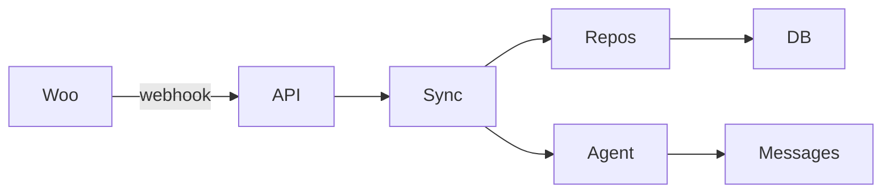

# CRM WooCommerce
FastAPI CRM integrating WooCommerce via webhooks and REST import.
## Quick start
cp .env.example .env (optional)
pip install -r requirements.txt
make test
uvicorn app.main:app --reload
## Architecture

## API
| Method | Path | Desc |
|POST|/webhook/woocommerce|ingest event|
|POST|/import|initial import|
|GET|/customers|list|
|GET|/orders?status=|list|
|GET|/messages|log|
|GET|/health|health|
